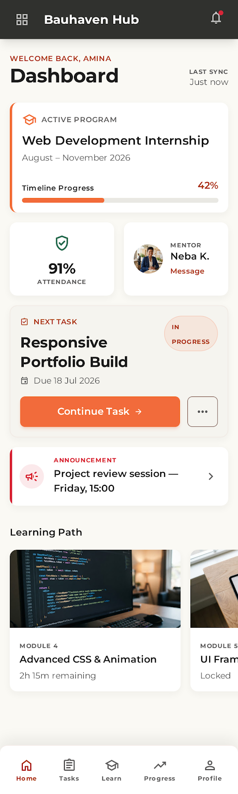
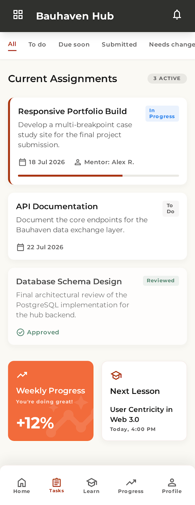
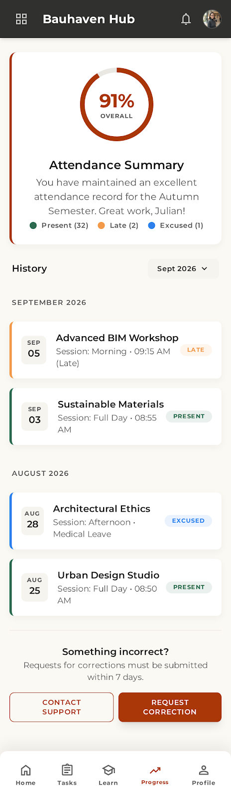

<div align="center">

  

  # Bauhaven Academy (Web)
  ### Responsive Learner Portal & Deliverables Hub

  <p align="center">
    <strong>The browser-based learning environment for Bauhaven interns, students, and apprentices.</strong><br>
    Track curriculum progress, submit project deliverables, view mentor feedback, and monitor attendance on any phone, tablet, or laptop.
  </p>

  <p align="center">
    <a href="#key-features">Key Features</a> •
    <a href="#visual-showcase">Visual Showcase</a> •
    <a href="#phone-first-experience">Phone-First Design</a> •
    <a href="#tech-stack">Tech Stack</a> •
    <a href="#getting-started">Getting Started</a> •
    <a href="#ecosystem">Ecosystem</a>
  </p>

  <p align="center">
    
    
    
    
    
    
  </p>
</div>

---

## ⚡ Overview

**Bauhaven Academy (Web)** is the accessible, universal web portal connecting learners to their training programs at Bauhaven. Built specifically with a **phone-first philosophy**, it ensures that participants who do not have continuous access to a desktop computer enjoy an ergonomic, native-feeling mobile experience directly in their web browser.

Sharing the exact same single-sign-on credentials and live Supabase database as the native **Bauhaven Hub** mobile app, students can move seamlessly between devices: checking deadlines on their phone while on the bus, and handing in complex coding projects from their laptop in the studio.

```
┌────────────────────────────────────────────────────────────────────────┐
│                      BAUHAVEN ACADEMY WEB PORTAL                       │
├─────────────────┬────────────────────┬─────────────────────────────────┤
│ Personal Hub    │ Hand-in Engine     │ Campus Connection               │
│ • Cohort Status │ • File Attachments │ • Roll-Call Record & Percentage │
│ • Due Milestones│ • External Links   │ • Absence Request Filing        │
│ • Mentor Tips   │ • Revision Cycles  │ • Direct Android Hub Download   │
└─────────────────┴────────────────────┴─────────────────────────────────┘
```

---

## 📱 Visual Showcase

<div align="center">
  <table>
    <tr>
      <td width="33%" align="center">
        <strong>Learner Dashboard</strong><br>
        
        <br><em>Active program overview, attendance percentage, and next upcoming deadline.</em>
      </td>
      <td width="33%" align="center">
        <strong>Tasks & Deliverables</strong><br>
        
        <br><em>Filterable task stream with submission prompts and revision history.</em>
      </td>
      <td width="33%" align="center">
        <strong>Attendance Scorecard</strong><br>
        
        <br><em>Session history, graduation benchmark tracker, and absence request forms.</em>
      </td>
    </tr>
  </table>
</div>

---

## ✨ Key Features

### 📱 1. Phone-First Responsive Ergonomics
- **Bottom Navigation Bar**: Native app-like thumb navigation allowing one-handed mobile browsing.
- **Adaptive Layout**: Automatically scales into an elegant centered desktop column when accessed on wider screens.
- **Fast Load on Cellular Data**: Highly optimized asset footprint with zero bloated third-party analytics.

### 📝 2. Multi-Format Assignment Submissions
- **Versatile Hand-ins**: Submit written project responses, upload binary project files, or link directly to GitHub repositories, live demo URLs, and Figma design boards.
- **Continuous Feedback**: Inspect comments left by mentors, review rubric scores, and re-submit revised versions when alterations are requested.

### 📊 3. Attendance Tracking & Graduation Benchmarking
- **Attendance Scorecard**: Live percentage calculation comparing attended sessions against total held sessions.
- **Detailed History**: Complete chronological log of attended classes, excused absences, and late arrivals.
- **Absence Requests**: File formal leave requests in advance with automatic notifications delivered to cohort mentors.

### 📦 4. Native Android App Gateway
- **Direct APK Distribution**: Direct, verified download link to the native **Bauhaven Hub APK** (`/downloads/bauhaven-hub.apk`) accessible right from the application header and profile screen.

### 🔐 5. Frictionless Onboarding & Security
- **Token-Based Activation**: Applicants accepted through admissions receive an encrypted email link that leads directly to `/auth/confirm` and password initialization.
- **Participant Isolation**: Server-side Row Level Security (RLS) ensures learners can strictly access only their personal submissions and enrolled cohort data.

---

## 🏗️ Architecture & Codebase Layout

```text
Bauhaven-Academy-Web/
├── src/
│   ├── app/                      # Next.js App Router (Server Components & Actions)
│   │   ├── (app)/                # Authenticated participant portal
│   │   │   ├── attendance/       # Roll-call history & absence request form
│   │   │   ├── feedback/         # Student satisfaction surveys & testimonials
│   │   │   ├── profile/          # Student profile, app downloads & sign-out
│   │   │   ├── tasks/            # Assignment briefs & submission forms
│   │   │   └── page.tsx          # "Today at a glance" learner dashboard
│   │   └── (auth)/               # Login, account activation & password reset
│   ├── components/               # Phone-first UI cards, nav bars, and status pills
│   ├── lib/                      # Supabase SSR clients, date formatters & schemas
│   └── types/                    # Database interface definitions
└── public/
    └── downloads/                # Standalone native Bauhaven Hub APK binary
```

---

## 🚀 Getting Started

### Prerequisites
- [Node.js](https://nodejs.org/) (`>= 20.x`)
- [npm](https://www.npmjs.com/)

### Installation

1. **Clone the repository**:
   ```bash
   git clone https://github.com/bauhaven/Bauhaven-Academy-Web.git
   cd Bauhaven-Academy-Web
   ```

2. **Install dependencies**:
   ```bash
   npm install
   ```

3. **Configure Environment Variables**:
   Copy `.env.example` to `.env.local`:
   ```bash
   cp .env.example .env.local
   ```
   Configure your Supabase client settings:
   ```env
   NEXT_PUBLIC_SUPABASE_URL=https://your-project.supabase.co
   NEXT_PUBLIC_SUPABASE_ANON_KEY=your-anon-publishable-key
   NEXT_PUBLIC_ACADEMY_URL=http://localhost:3000
   ```

4. **Start development server**:
   ```bash
   npm run dev
   ```
   Open [http://localhost:3000](http://localhost:3000) on your phone or browser.

5. **Run tests & typecheck**:
   ```bash
   npx tsc --noEmit
   npm test
   ```

---

## 🌐 The Bauhaven Ecosystem

| Component | Platform | Description |
|:---|:---|:---|
| **[Bauhaven Hub](../bauhaven-hub2)** | Flutter (Mobile) | Native Android client with offline draft protection |
| **[Bauhaven Admin (Web)](../Bauhaven-Admin-Web)** | Next.js 16 | Institutional desktop console for admissions, attendance, and analytics |
| **[Bauhaven Admin (Mobile)](../bauhaven-admin)** | Flutter (Mobile) | Operations console for on-site staff and floor coordinators |
| **[Bauhaven Finance Tracker](../bauhaven_ft)** | Flutter (Mobile) | Dual-currency cash & mobile money ledger for finance directors |
| **[Bauhaven Website](../bauhaven-website)** | Next.js 16 | Public admissions portal, catalog, and institutional showcase |

---

<div align="center">
  <p><sub>Empowering the next generation of creative technologists with <strong>Bauhaven</strong>.</sub></p>
  <p><sub>© 2026 Bauhaven Creative Technology. All rights reserved.</sub></p>
</div>
